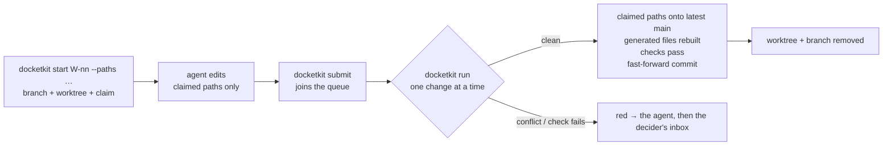

# SR-ARCHITECTURE — docketkit lands agent changes into main, one at a time

## §1 — For humans

**docketkit is a doorman for `main`.** Agents never commit to `main`
themselves. Each one says which files it will touch, works in its own
throwaway folder, and hands its change in. docketkit puts the changes onto
`main` **one at a time** — like a canal lock-keeper letting one boat through —
and cleans up after each.

**It is not a new version control system.** Every landing is an ordinary git
commit; `git log` reads the history with nothing else installed.

**It never loses work.** It never forces anything. A change that cannot land
cleanly — a real conflict, a failed check, a file that would be lost — stops
**red** and goes to the decider.



<details>
<summary><b>ASCII twin</b></summary>

```text
   start (branch + worktree + claim) --> agent edits claimed paths --> submit (queue)
                                                                          |
                                         run: one change at a time <------+
                                           | clean: claimed paths onto latest main,
                                           |        generated files rebuilt, checks,
                                           |        fast-forward commit, worktree removed
                                           | conflict / failed check: red -> agent -> decider
```

</details>

---

## §2 — For agents

### Context

On one laptop, several agents work in one repository at once. The work
system's own logs (fux, sheetpane, codelaw, 2026-09 to 2026-10) recorded the
same failures again and again: one session's commit swept another session's
staged files; generated files (`CHANGELOG.md`, `llms-full.txt`, an index)
conflicted whenever two agents touched them; worktrees piled up until the disk
filled; finished work sat on branches nobody merged; `NOW.md` and the inbox,
edited by hand, stopped matching git. Anthropic's own answer at
30,000 merges a day was a new, server-side source-control system; at one laptop
the same ideas fit on top of git (`work/compare/source-control.compare.md`).

### Decision

**What it is**

1. **A command-line tool over plain git, not a version control system.** Every
   landing is an ordinary commit on `main`; history, blame and diff are git's.
   No docketkit state is needed to read the repository.
2. **Python ≥ 3.9, standard library only** ([SR-LAW-4](0006_LAW-4-zero-dependencies.md)). 3.9 is the `python3` on the
   decider's Mac ([`work/MACHINE.md`](../work/MACHINE.md)); the tool and every
   hook run there unchanged. Code lives in `src/docketkit/`; the command is
   `docketkit` (`python3 -m docketkit` works without installing).
3. **Its state lives inside git's own directory**, at
   `$(git rev-parse --git-common-dir)/docketkit/` — shared by every worktree,
   never committed, gone with the clone. A change is one JSON file in
   `changes/`; the land lock and the throwaway landing worktrees live there too.

**A change**

4. **A change is a claim:** a work-item id, the paths it may touch (a file, a
   directory above it, or a glob), a branch `dk/<item>` and a worktree at
   `.claude/worktrees/<item>`, kept out of the main checkout's status through
   `info/exclude`. `docketkit start` creates all three;
   `docketkit claim add <path>` widens the claim.
5. **Only claimed paths land.** Anything else the branch changed, committed or
   not, is left behind and reported, never swept in. `submit` commits only the
   claimed paths in the worktree. A kit hook (`claim-guard.py`) warns — never
   refuses — when an agent writes inside a change's worktree outside its claim.
6. **`docketkit submit` queues the change and starts `docketkit run`
   when no lander holds the land lock;** a lander already running picks the
   change up. Nobody has to remember to land; the lock still keeps it to one
   at a time (ruled 2026-10-25, W-02).

**Landing**

7. **One lander at a time.** `docketkit run` takes the repo's land lock (a
   `mkdir` mutex in the state directory, holding the lander's pid) and lands
   queued changes oldest first. A second lander exits and leaves the queue to
   the first. A lock whose pid is dead is stale and taken over; a change it
   left mid-landing is queued again — `main` had not moved.
8. **A landing, in order:** take the claimed paths' diff against the change's
   merge base, generated files excluded, as one commit; cherry-pick it onto the
   latest `main` in a fresh worktree in the state directory; rebuild every
   generated file (decision 9); run the repo's checks; commit — the repo's own
   commit hooks run — with the item id in a `Docketkit-Change:` trailer;
   fast-forward `main`. **When the whole branch landed**, the landing commit
   also records the branch tip as a second parent, so git itself can prove the
   branch merged and `git branch -d` removes it ([SR-LAW-3](0005_LAW-3-never-lose-work.md)
   decision 2). `main` is fast-forwarded where it is checked out
   (`merge --ff-only`, so that checkout moves with it, and refuses to overwrite
   its local edits) or else by `update-ref` against the old value; if `main`
   moved meanwhile, the landing is redone on the new `main`, up to three times.
   Then the change's worktree and branch are removed if nothing in them can be
   lost ([SR-WORK-CLEANUP](0062_WORK-cleanup.md) decisions 1–2); what cannot
   be is kept and reported. A failed attempt's landing worktree is committed
   to its own detached HEAD before it is removed.
8a. **Edits in `main`'s checkout that are the landing's own do not stop it**
   (2026-10-28, W-11). Before the fast-forward, docketkit compares each
   uncommitted path in `main`'s checkout that the landing changes with the
   landing's version. When every one is byte-for-byte the same — edits made in
   the checkout and landed by `save` (decision 19), or a Cowork edit another
   session committed — they are staged, which loses nothing, and git takes the
   fast-forward. When any differs, nothing is staged and the change **waits**
   (decision 11), its reason naming the differing paths, never an empty line.
   **The ledger, `work/NOW.md`, never makes a landing wait** (2026-11-07, W-10):
   it is live state, rewritten by the kit's hooks and by every landing
   ([SR-WORK-NOW](0061_WORK-now.md)), so a landing that changes it carries the
   checkout's copy instead — the landing commit is rewritten with that one file
   replaced, its parents, author and message kept. `save` once blocked itself
   this way: its worktree's row was written after its copy was taken.
9. **Generated files are never merged, only rebuilt.** Each repo lists them,
   with the command that rebuilds each, in `docketkit.toml` `[generated]`.
   Rebuilding restores each to `main`'s version first — unless it has
   uncommitted edits, which are refused by name, never overwritten — then runs
   its command; a failing command fails the landing. `docketkit regen` does
   the same by hand.
10. **Hand-written files with a known shape merge structurally** —
    `append-newest-first` (a worklog), `table-rows` (a queue), `append` (a
    lessons file) — as git merge drivers `docketkit drivers` registers in
    `.git/config`, with `[merge]`'s paths written into a block of
    `.gitattributes` docketkit owns. When both sides only inserted lines at
    the same place, both insertions are kept: the landing change's on top for
    `append-newest-first`, in landing order otherwise, and a row both sides
    added kept once for `table-rows`. Anything else goes to `git merge-file`,
    so a true conflict still conflicts. Plain `git merge` uses them too.
    **A driver names the machine that registered it** — its interpreter and
    `merge.py` paths — so it is registered only where docketkit commits
    (2026-10-28, W-11; registered from the Cowork bridge, twice, it named the
    bridge's paths): `install` on a surface that cannot commit (decision 19)
    writes `.gitattributes` and registers nothing, every `docketkit run`
    re-points a driver whose interpreter or `merge.py` is missing on this
    machine, and `doctor` names one.
11. **Red, never forced.** A conflict outside a structural merge, a failed
    rebuild or check, a refused commit, or local edits in `main`'s checkout
    stop that change: it is marked red
    with the reason, and the agent is told — with the inbox row
    ([SR-WORK-OPEN-QUEUE](0051_WORK-open-queue.md) rule 42's shape) ready to
    add if it cannot fix it. docketkit never forces, deletes an unmerged
    branch, hard-resets, cleans or force-pushes
    ([SR-LAW-3](0005_LAW-3-never-lose-work.md) decision 3). **A red change is
    set aside and the next queued change lands** (ruled 2026-10-25, W-02): one
    bad change does not hold up the rest. It stays in `docketkit queue`,
    marked red with its reason, until it is fixed and resubmitted or abandoned.
    An auto-landing (decision 20) that cannot land is **held**, not red.
    **Uncommitted edits in `main`'s checkout that the fast-forward would
    overwrite are not red either: the change is waiting** (2026-11-07, W-10;
    [SR-LAW-9](0011_LAW-9-cowork-and-claude-code-together.md) decision 4).
    The landing commit — rebuilt, checked and committed — is kept under
    `refs/docketkit/waiting/<item>`; every `docketkit run` (and so every
    `submit`, `save`, `pickup` and end-of-turn `sync`) looks again and, once
    those edits are committed, handed off or undone, fast-forwards it with no
    resubmit and no second run of the checks. If `main` moved meanwhile, the
    landing is redone on the new `main` (decision 8), never fast-forwarded from
    a stale base. A change queued behind a waiting one still lands. A kept
    landing waits the same way and stays open once it lands; `SessionEnd`
    finishes it instead. The checkout's edits are never touched
    ([SR-LAW-3](0005_LAW-3-never-lose-work.md)). `docketkit status` and
    `doctor` name each uncommitted path in the checkout that a queued, waiting
    or open change claims, with the change, before it lands; the kit's
    `claim-guard.py` warns a session that edits such a path there. A session
    with no hooks (Cowork) sees only `status`, `doctor` and `queue`.
12. **Only docketkit writes to `main`.** A kit hook (`block-main.py`) refuses
    an agent's `git commit`, `merge`, `cherry-pick`, `revert`, `am` or `rebase`
    while `main` is checked out. **A plain push of `main` passes** (ruled
    2026-10-26): every option on the hook's allow-list and no refspec that
    forces (`+`) or deletes, so the remote takes only a fast-forward of the
    landings. Any other push that would update `main` is refused, an unknown
    option included. A heredoc's body is input, not commands, and is not judged.
    On Windows a backslash in the command is a path's, not an escape
    (2026-11-09, W-19: `git -C C:\…` was read as `C:…` and passed).
    docketkit's own landing runs git inside `docketkit`, not through the
    agent's shell tool, so it passes. The hook binds agent sessions only: the
    decider's own terminal can still commit to `main`.

**Configuration**

13. **`docketkit.toml` at the repo root** — `[main]` (the branch), `[checks]`
    (name → command, run in the platform's shell — `cmd.exe` on Windows; each
    must pass), `[generated]` (path or glob → rebuild
    command), `[merge]` (path or glob → structural driver), and an optional
    `[land]` whose only key, `auto`, is `"on"` (the default) or `"off"`
    (decision 20). Five tables of string values, nothing else; anything outside that subset is a loud error.
    It is read with `tomllib` on Python ≥ 3.11, checked against docketkit's
    own reader of the same subset — the reader used on 3.9–3.10 — so a file
    means the same on every Python and no dependency is added.

**Commands**

14. | command | who | what it does |
    |---|---|---|
    | `docketkit start <item> --paths …` | agent | branch + worktree + claim |
    | `docketkit claim add <path>` | agent | widen the claim |
    | `docketkit submit` | agent | join the queue |
    | `docketkit run` | `submit`, a hook, or anyone | land queued changes, one at a time |
    | `docketkit queue` | the decider | what is waiting, landed or red |
    | `docketkit status` | anyone | live sessions, changes, worktrees, disk use against L2's budget; `--now` prints `work/NOW.md` as it should be, `--write-now` writes it |
    | `docketkit abandon` | agent or the decider | drop a change; remove its worktree and branch only if nothing is lost |
    | `docketkit save -m … <path>…` | Cowork, or any session that edited `main`'s checkout | land those edits, or hand them off where this surface cannot commit (decision 19) |
    | `docketkit pickup` | the kit's hook, or anyone | land the handoffs (decision 19) |
    | `docketkit sync` | the kit's hook | land a session's open changes now (decision 20) |
    | `docketkit can-commit` | anyone | whether this surface can commit (exit 0) or hands off (exit 1) |
    | `docketkit doctor` | anyone | stale locks, orphan worktrees, unmerged branches, an installed kit that is not this docketkit's, a waiting change and the checkout edits a change's landing would wait on |
    | `docketkit install <repo>` | the decider | install a pinned kit into a repository; create any of the six work files it lacks |
    | `docketkit regen` | anyone | rebuild the `[generated]` files by hand |
    | `docketkit drivers` | the decider | register the merge drivers; write `[merge]` into `.gitattributes` |

    **`work/NOW.md` is `docketkit status --now`'s view:** its sessions are the
    sessions' own (the kit's `now-ledger.py` adds and closes them, a Cowork
    session by hand); a resource row whose path is gone leaves; the file is
    written in one shape by every landing and by `now-ledger.py`, which writes
    through docketkit's renderer when docketkit is importable.

**The kit**

15. **`kit/` is what docketkit installs into a repository:** `kit/claude/`
    (the hooks, their `settings.json`, the `inbox-review` skill) becomes the target's
    `.claude/`, and `kit/github/` (none today) its `.github/` — a repository's
    CI is its own (decision 16; amended 2026-10-25, W-09: the kit carried
    docketkit's own `ci.yml`, which would have replaced the target's). One source, installed —
    never three hand-copied versions. `docketkit install` copies it, merges
    the kit's hook entries into the target's `settings.json` (the target's own
    entries and keys kept), and records the version, the kit's digest and every
    installed file's hash in `.claude/docketkit.lock`, which `doctor` checks.
    A file the kit would replace that no earlier install wrote stops the
    install by name, or with `--backup` is moved aside first. This repository
    installs its own kit the same way; `scripts/bootstrap.py` is retired
    (2026-10-25, W-06). The kit's hooks read any repository's inbox heading and
    name no law number (2026-10-26, W-09); the `inbox-review` skill names no queue
    group, and walks the groups each queue lists (2026-11-08, W-15: codelaw
    had edited its copy to add its own; `tests/test_kit_hooks.py` fails on a
    kit skill that lists the queue's groups). **`kit/work/` holds a short template
    of each of the six work files** ([SR-LAW-10](0012_LAW-10-work-files-current.md)
    decision 6; 2026-11-07, W-15): `install` writes each one the target lacks
    and never touches one that exists; they are the project's own papers
    (decision 16), not kit files, so the lock does not record them. `doctor`
    names a missing one, and a `WORKLOG.md` that `main` has moved more than ten
    commits past; the kit's `work-files.py` tells a session, once at `Stop`,
    that wrote files outside `work/` but none of `WORKLOG.md`, `INTERVIEW.md`
    or `OPEN-WORK.md`. **`kit/scaffold/` holds the rest of the work system**
    (2026-11-08, W-18): `AGENTS.md`, `docs/GLOSSARY.md`, the generic records
    (the register, `TEMPLATE.md`, `RULE-SINCE`, SR-LAWS, SR-LAW-0 to SR-LAW-2,
    the WORK records and SR-WORK-LANDING, which owns the four landing hooks in
    a repository that is not docketkit), `work/README.md`, `NOW.md`,
    `BLOCKED.json`, `IMPLEMENTATION.md` and the `open/`, `compare/` and
    `proposals/` indexes, `archive/README.md` (kept as `_archive/`, so docketkit's own
    one-archive check does not read it as a second archive), and the work system's three
    scripts. `install` writes each file the target lacks at the same path and
    never touches one that exists; `records/` and `scripts/` only when the
    target has no `records/` at all, so a register of its own is never mixed
    with the kit's numbering. Like the six, they are the project's own papers,
    not kit files, and the lock does not record them. The one template slot is
    `{{installed}}`, today's date, so the empty inbox is well-formed (rule 45a).
    `tests/test_scaffold.py` installs into a scratch repository and runs its
    own `check-work-system.py`, `check-open-work-inbox.py`, `doctor` and commit
    guard over the result.
16. **What stays in each repository:** its records, work items, backlog,
    worklog, lessons — the project's own papers — its CI, and its `docketkit.toml`.

**Distribution**

17. **Python only, on PyPI only** ([SR-LAW-6](0008_LAW-6-python-only.md)):
    one package, `docketkit`; no npm package. **The repository stays private
    until 0.1.0** — public once the core loop works (ruled 2026-10-25, W-02);
    a placeholder 0.0.1 on PyPI holds the name before then (W-08). **Until
    the trusted publishers and the GitHub environments exist, a release is
    uploaded from the decider's machine** (ruled 2026-11-08: 0.0.1 by the
    decider, *"commit push and publish a new version"* for 0.0.2 — no
    environment exists, so a tag cannot publish); the release is tagged, and
    its tag pushed only once they exist — a pushed tag starts the pipeline,
    which cannot publish yet. Once they exist (W-17), only a tag publishes.
    **Every repository but docketkit runs the published package** (ruled
    2026-11-08, W-16: *"from here on we publish the package then have all
    consumer consume it"*): `uv tool install docketkit` (or pipx) once per
    machine; `docketkit install .` and `docketkit drivers` run from that
    command, so the kit and the merge drivers come from the release. The
    kit's hooks find docketkit at `$DOCKETKIT_SRC`, in the repository's own
    `src/` (docketkit itself), as an importable package, or in the
    `docketkit` command's own environment — never in a checkout beside the
    repository; a change to docketkit reaches another repository only by a
    release.
    **A release is a tag `v<version>`, and only a tag publishes.**
    `.github/workflows/release.yml` — docketkit's own, never in `kit/` —
    runs the tests on Linux (`ubuntu-24.04`: Python 3.9 has no build for
    26.04), macOS and Windows under Python 3.9 and 3.13 and
    the work-system checks; checks that the tag, `docketkit.__version__` (the
    one version source) and a `CHANGELOG.md` section agree
    (`scripts/release.py check`); builds the sdist and wheel, `twine check`s
    them and confirms the wheel carries every kit file; installs the wheel
    alone on every OS and Python, installs the kit into a scratch repository
    with it and lands one change; then publishes to TestPyPI and to PyPI by
    trusted publishing (no stored token), PyPI behind the `pypi` environment's
    reviewer; then creates the GitHub release from the CHANGELOG section.
    `scripts/release.py prepare <version>` cuts a version. The wheel carries
    `kit/` as `docketkit/kit`, so `docketkit install` works from a pip
    install.

**The repository's own git hooks**

18. **docketkit's own git steps run a repository's gate hooks, not its post-*
    hooks** (2026-10-26, W-09). Every git command docketkit runs carries
    `-c core.hooksPath=<git-common-dir>/docketkit/hooks`, where a forwarder for
    each gate hook — `pre-commit`, `prepare-commit-msg`, `commit-msg`,
    `pre-merge-commit`, `pre-rebase`, `pre-push`, `applypatch-msg`,
    `pre-applypatch` — runs the repository's own (its `core.hooksPath` or
    `.git/hooks`). So a commit guard still refuses a landing, and a post-commit,
    post-merge or post-checkout side effect does not run inside a worktree
    docketkit is about to remove or in `main`'s checkout. **What a landing must
    produce, it produces through `[generated]`** (decision 9) — in fux, the
    committed index. A person's or an agent's own git commands are untouched.

**Every surface lands, and landing does not wait for the end** (Arpit,
2026-10-28: *"As soon as the changes are done, it should keep merging it to
main so that there aren't too many conflicts later on … If co-work can commit
it, then it should go ahead and commit it. If co-work cannot commit it, then
probably Claude Code should go ahead and commit it."*)

19. **A surface that cannot commit hands its edits to one that can** (W-11).
    `docketkit save -m … <path>…` lands uncommitted edits made directly in
    `main`'s checkout: a change is started on the paths, the checkout's
    versions are copied into its worktree, and it is submitted (decisions 6–8,
    with 8a accepting the checkout's identical edits). It first asks whether
    this surface can commit (`surface.py`): it must be able to remove a file
    in the state directory (the Cowork bridge cannot, so git's lock files
    would stay), and the checkout must not be another machine's seen through a
    mount — git lists worktrees that do not exist here, outside this checkout,
    under the state directory's `home` (the primary checkout's path where
    docketkit first committed, written once, else read off its changes'
    worktree paths) or
    at a `.claude/worktrees/` path: a prune from here would cut them off. Every
    git command docketkit runs takes no optional locks, so even reading leaves
    no `index.lock` on a surface that cannot remove it. Where it cannot, `save` writes a **handoff** — one new
    file in `handoffs/` naming the paths, the message and who handed it over,
    written aside and renamed in, so nothing is removed — says so in one line,
    and exits 0: handing off is success, not a problem for the decider. The
    kit's `auto-land.py` runs `docketkit pickup` on a Claude Code session's
    start and at the end of each of its turns — no background job
    ([SR-LAW-9](0011_LAW-9-cowork-and-claude-code-together.md) decision 2). A
    handoff's name is taken exclusively, so two written at once never
    overwrite each other, and it records each file's content digest.
    Handoffs that name a common file land together, as one change under the
    newest one's message with the earlier ones listed. Each is saved; one whose
    edits are already on `main` or reverted is dropped; one with a file
    edited after it was handed off, and not handed off again, is **held** —
    nothing lands — and said once, until that edit is handed off or undone;
    one that goes red keeps
    its one change, is reported once to that session's agent — who fixes the
    files where they are, in `main`'s checkout — and is retried on that same
    change only once those edits change. One failing handoff never stops the
    rest. A pickup re-reads the handoffs before it lets go of its lock, and
    stamps when it ran; `queue` marks a handoff older than that stamp, with no
    reason given, `MISSED`.
20. **A Claude Code session's changes land at the end of every turn** (W-11).
    The kit's `auto-land.py` exports the session's id at its start, so
    `docketkit start` records whose change it is, and at each `Stop` starts
    `docketkit sync --pickup` in the background — a landing runs the checks
    and rebuilds, which takes fux ten minutes, accepted (B-007), so no turn waits on it;
    what it landed, held or could not land is said at the next `Stop`. It
    lands on a surface that can commit only: every open change
    of that session (by its recorded id; only a change with none is matched by
    the worktree holding the session's directory, so standing in another
    session's worktree never lands it) that holds claimed work not on `main`
    (generated files aside; a path whose content is already `main`'s is not
    pending) is committed and landed **kept** — it stays open, and
    its worktree is brought up to the landing (a fast-forward, or a merge when
    committed paths outside the claim stayed behind), so the next turn builds
    on `main` and conflicts stay small. A kept landing that cannot land is
    **held**: the change stays open with the reason, nothing goes to the
    decider, the agent is told once per state of the change, and the next turn
    tries again. A worktree docketkit did not create — `claude --worktree`,
    an agent's own — is **adopted** as a change claiming everything it
    changed, landed the same way, and never removed by docketkit; once its
    owner removes it, the change is abandoned; a branch with no history in
    common with `main` is not adopted. At `SessionEnd`, in the background,
    the session's changes are landed and cleaned up as by `submit`; one with
    nothing new is finished — landed if it landed kept before, else
    abandoned — its worktree and branch removed if nothing is lost.
    Files the session wrote straight into `main`'s checkout are noted, and at
    `Stop` the agent is told once to `save` them. A `Stop` reached while
    already continuing for a `Stop` hook never blocks again: it only says.
    Two end-of-turn landings of one session never run at once: a turn's end
    skips while one runs (the next turn retries), the session's end waits for
    it ([SR-LAW-8](0010_LAW-8-parallel-requests.md)).
    `[land] auto = "off"` turns it off.

21. **The tool is named docketkit** (ruled by the decider, 2026-11-17): it is
    a way of working in a repository, not only a lock. The package, the module
    and the repository are `docketkit`; the command is `docketkit`, with `dk`
    as a second name for the same entry point; branches are `dk/<item>`; the
    trailer is `Docketkit-Change`; the kit's queue walk-through skill is
    `inbox-review` (the name `docket` was the skill's). What the old name left
    in a repository still works, and moves without loss (SR-LAW-3): `lockmaster.toml`
    is read until `docketkit.toml` exists; `.git/lockmaster/` is renamed to
    `.git/docketkit/` the first time docketkit opens the repository; `install`
    reads `.claude/lockmaster.lock` and replaces it; `drivers` replaces the old
    `.gitattributes` block; `lm/` branches are still docketkit's own; a landing
    sets `LOCKMASTER_LANDING` and `LOCKMASTER_CHANGE` beside the new names for a
    repository's hooks. History keeps the old name: `Lockmaster-Change`
    trailers are read beside the new one, and `archive/`, the worklog and the
    changelog's released entries are not rewritten. Test: [`tests/test_rename.py`](../tests/test_rename.py).

### Consequences

- Landings are serial by design: on one laptop that is the point (one build at
  a time is also what L2's budget wants), at the cost of a queue that waits.
- Two agents changing the same lines with different intent is still a
  conflict; docketkit stops and asks, a person decides.
- Decisions 19 and 20 land work every turn: `main` sees work in progress
  that passes the checks, and a repository whose checks are slow pays that
  time at the end of each turn that changed something.
- Decisions 1–17 are built (W-03 to W-07, and the release pipeline) and
  tested on scratch repositories under `tests/`; publishing waits on the
  decider's one-time trusted-publisher setup (W-08).
- `main`'s first-parent chain is exactly the landings; an agent's own commits
  are reachable through a landing's second parent. `git log --first-parent`
  reads the landings alone.
- Distribution is PyPI alone (decision 17); a Node repository runs it through
  `python3`.

### Alternatives considered

- **A new version control system, as Anthropic built for its monorepo** —
  rejected: its own authors call it unsuitable for general use; the problem
  here is concurrency on one machine, not scale.
- **A merge queue on a forge (GitHub's)** — rejected: needs a server round trip
  per change and does not stop the local sweeps, the worktree pile-up or the
  generated-file conflicts.
- **A red change stops the queue until fixed** — rejected by the decider,
  2026-10-25 (W-02): one bad change should not hold up the rest.
- **An npm package beside PyPI** — rejected by the decider, 2026-10-25 (L6).
- **Jujutsu (`jj`) as the front end** — not rejected; held in
  `work/compare/source-control.compare.md` as the fork to reopen.

### Reference (required)

- [`kit/claude/hooks/auto-land.py`](../kit/claude/hooks/auto-land.py) and [`kit/claude/skills/landing/`](../kit/claude/skills/landing/SKILL.md) — decisions 19–20; `src/docketkit/surface.py` (19); `land.py`'s `save`, `handoff`, `pickup`, `sync`, `adopt` (19–20), `_classify` and `_carry_ledger` (8a), `retry_waiting` and `checkout_overlaps` (11); [`tests/test_autoland.py`](../tests/test_autoland.py), [`tests/test_waiting.py`](../tests/test_waiting.py).
- [`kit/`](../kit) — decisions 5, 12 and 15; [`kit/work/`](../kit/work) and [`kit/claude/hooks/work-files.py`](../kit/claude/hooks/work-files.py), [`tests/test_work_files.py`](../tests/test_work_files.py) (15, SR-LAW-10); [`kit/claude/hooks/claim-guard.py`](../kit/claude/hooks/claim-guard.py) (5), [`kit/claude/hooks/block-main.py`](../kit/claude/hooks/block-main.py) (12).
- [`src/docketkit/`](../src/docketkit) — decisions 1–15 and 21: `land.py` (4–8, 11), `generated.py` (9), `merge.py` and `drivers.py` (10), `config.py` (13), `status.py` and `now.py` (14), `install.py` and `doctor.py` (14–15).
- [`tests/`](../tests) — one scratch-repo test file per work item that built them.
- [`docketkit.toml`](../docketkit.toml) — this repository's own checks and merge drivers (decision 13).
- [`.github/workflows/release.yml`](../.github/workflows/release.yml), [`scripts/release.py`](../scripts/release.py), [`pyproject.toml`](../pyproject.toml) — decision 17.

### Veto condition

**Reopen this decision if:** a landing ever needs a forced git operation, or `main` holds a commit docketkit did not make while the block-main hook is installed.

**How to check it:** `grep -rnE -- "--force|branch -D|reset --hard|git clean" src kit` prints nothing, and `git log --first-parent --format='%h %(trailers:key=Docketkit-Change,key=Lockmaster-Change,valueonly)' main` shows a trailer on every commit after the hook's install.

---

## References

**Records** — [SR-LAW-3](0005_LAW-3-never-lose-work.md) · [SR-LAW-4](0006_LAW-4-zero-dependencies.md) · [SR-LAW-6](0008_LAW-6-python-only.md) · [SR-WORK-CLEANUP](0062_WORK-cleanup.md) · [SR-WORK-NOW](0061_WORK-now.md) · [SR-WORK-OPEN-QUEUE](0051_WORK-open-queue.md) · [SR-LAW-2](0004_LAW-2-machine-budget.md)

**Code** — [`src/docketkit/`](../src/docketkit) · [`kit/`](../kit) · [`tests/`](../tests) · [`docketkit.toml`](../docketkit.toml)

**Project docs** — [`work/compare/source-control.compare.md`](../work/compare/source-control.compare.md) · [`work/MACHINE.md`](../work/MACHINE.md)

**External** — [Redesigning source control at Anthropic](https://www.anthropic.com/engineering/redesigning-source-control) (2026-10-13)
